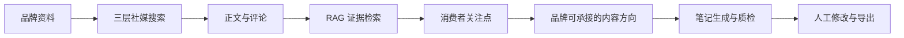
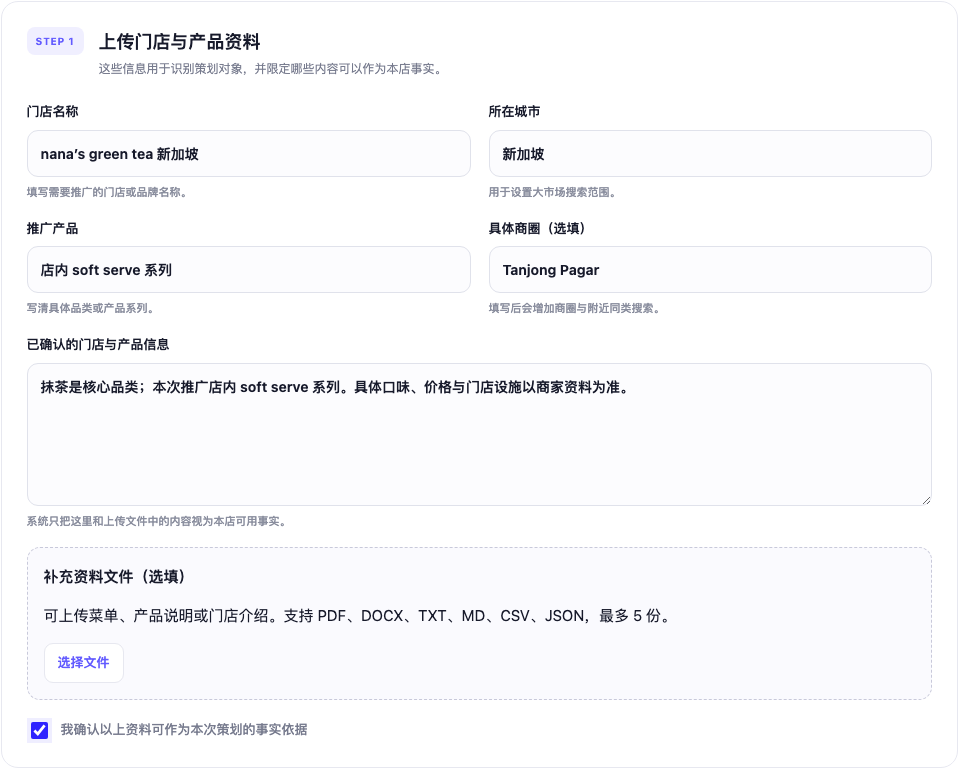
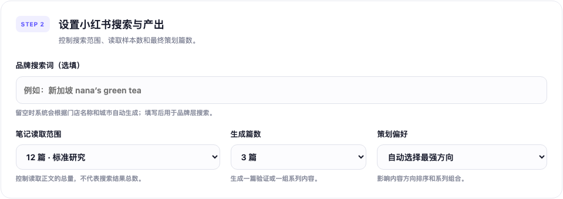
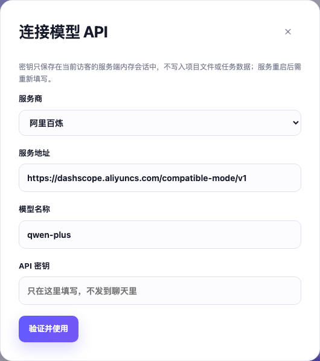
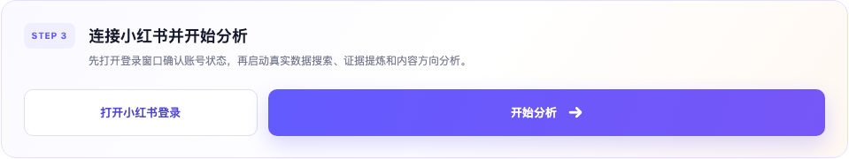
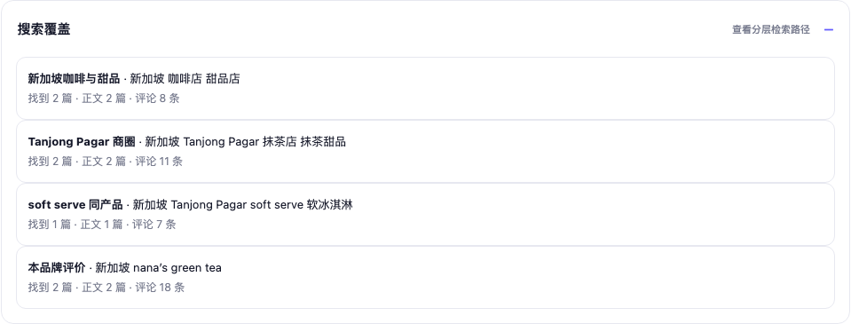
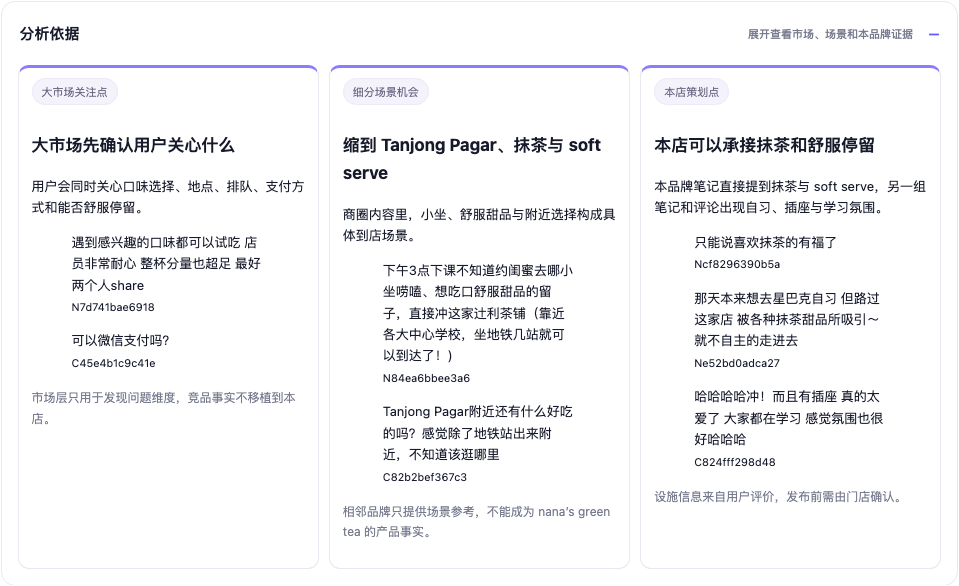
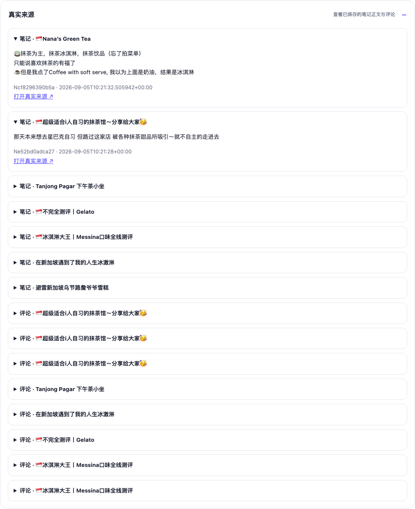
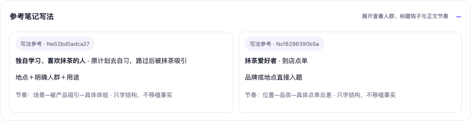
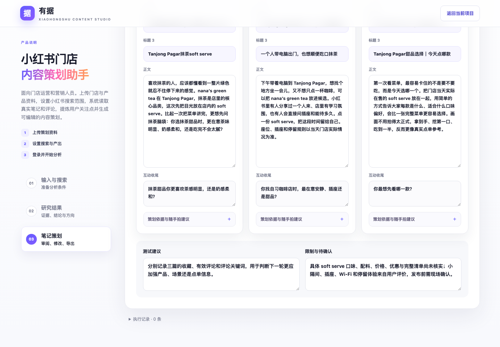

# 有据 Youju

### AI Social Insights & Content Planner

**把真实社媒反馈转化为有依据、可执行的品牌内容策划。**

有据面向本地消费品牌经营者、品牌营销和内容运营人员。用户提供要推广的门店与产品，系统研究小红书中的市场需求、细分消费场景和本店评价，找到消费者关注点与品牌事实的交集，再生成可编辑、可追溯的小红书笔记策划。

[在线体验](https://vibrant-communication-production-e59e.up.railway.app/) · [开发与部署说明](docs/DEVELOPMENT.md)

## 为什么做这个产品

品牌通常知道“这次要推广什么”，却不一定知道消费者为什么会感兴趣、同类内容正在谈论什么，以及应该用产品卖点还是消费场景切入。

人工研究需要反复搜索、阅读笔记和评论，再整理成选题；直接让通用模型写文案，又容易出现广告腔、卖点分散和缺少事实依据的问题。

有据把这项工作组织成一条可以检查的路径：

## 完整案例：nana’s green tea 新加坡

| 项目 | 本次任务 |
| --- | --- |
| 店名 | nana’s green tea 新加坡 |
| 地点 | Tanjong Pagar |
| 推广需求 | 推广店内全部 soft serve 产品 |
| 已确认信息 | 抹茶是核心品类；具体在售口味、价格和设施需要门店确认 |
| 策划设置 | 读取 12 篇以内的相关笔记，生成 3 篇，产品与场景均衡 |
| 实际研究记录 | 7 篇笔记、44 条评论；公开案例保留 15 条结论证据 |
| 最终产出 | 抹茶心智、午后停留、soft serve 点单 3 篇内容策划 |

下面按照一次真实使用的顺序展示产品。

## 第一步：输入策划对象与品牌事实

用户填写店名、城市、推广产品和具体商圈，也可以上传菜单、产品说明或门店介绍。填写的内容用于定义“本店确定能说什么”，避免模型把其他门店的卖点写成本店事实。

案例输入为 **nana’s green tea 新加坡、Tanjong Pagar、店内 soft serve 系列**，并明确抹茶是核心品类。

## 第二步：设置研究范围与内容目标

用户可以选择读取的笔记数量、最终生成篇数和策划偏好。策划偏好支持自动判断、产品与场景均衡、突出产品、突出环境，以及自定义目标人群和卖点。

本案例选择标准研究范围、生成 3 篇，并让产品信息与到店场景保持均衡。

## 第三步：连接个人账号与模型 API

用户在“模型设置”中填写自己的模型服务地址、模型名称和 API Key。API Key 只保存在当前访客的服务端内存会话中，不进入项目文件或案例数据；服务重启后需要重新填写。

随后打开登录窗口，通过自己的小红书账号完成登录，再点击“开始分析”。系统会显示搜索笔记、读取正文与评论、提炼关注点三个进度阶段。

## 第四步：MCP 执行分层搜索

系统通过只读小红书 MCP 调用搜索、笔记正文和评论读取工具。它不会只搜索品牌名称，而是按四组查询建立从市场到本店的研究范围：

1. **大市场：** “新加坡 咖啡店 甜品店”，发现当地消费者普遍关注的决策维度。
2. **商圈与相关品类：** “Tanjong Pagar 抹茶店 抹茶甜品”，理解附近消费场景。
3. **同产品：** “Tanjong Pagar soft serve 软冰淇淋”，缩小到相同产品形态。
4. **本品牌：** “新加坡 nana’s green tea”，寻找本店直接评价。

本轮实际保存 7 篇笔记与 44 条评论。页面同时展示每组搜索词、找到的笔记数、读取正文数和评论数。

当前版本采集与问题高度相关的真实搜索结果，并保留页面可见的互动信息；它不等同于小红书官方热度榜，也不会把互动数写成浏览量。

## 第五步：用三层漏斗形成营销判断

第一阶段 Prompt 按“大市场 → 细分场景 → 本店”完成漏斗分析，并要求每个结论引用原文：

- **大市场层：** 识别口味、位置、排队、支付方式和舒适停留等关注维度。
- **细分场景层：** 缩小到 Tanjong Pagar、抹茶和 soft serve，发现“小坐、舒服甜品、附近选择”等到店需求。
- **本店层：** 用本品牌笔记确认抹茶与 soft serve 的直接关联，并发现自习、插座和学习氛围等潜在场景。

每一层同时标注限制。例如，gelato 内容可以帮助发现用户如何讨论口味，却不能作为 soft serve 的产品证据；插座和停留体验来自用户评价，正式发布前仍需门店确认。

## 第六步：RAG 检索证据，结论可回看来源

采集内容先被整理为带来源 ID 的笔记与评论，再使用 **jieba + BM25** 进行轻量 RAG 检索。模型只能基于召回证据和商家资料提炼观点。

页面保留引用原文、来源 ID、采集时间和原始链接。营销人员可以展开检查某个判断来自哪篇笔记，确认它属于消费者关注点、本店评价，还是需要再次核实的门店事实。

## 第七步：内化小红书写作 Skill 的方法

产品参考并内化了开源 `xiaohongshu-ingest` Skill 中的写作分析框架，将一篇参考内容拆为 **目标人群、具体场景、需求、情绪、标题钩子、开场方式、正文节奏和互动收尾**。

它不是在运行时调用外部 Skill，而是把适合本产品的方法固化进 Prompt、结构化字段和质量规则中。系统只学习表达结构，不复制原文，也不把参考笔记中的事实移植给品牌。

具体参考与授权说明见 [THIRD_PARTY_NOTICES.md](THIRD_PARTY_NOTICES.md)。

## 第八步：生成“爆款结构”候选笔记

第二阶段 Prompt 将消费者关注点与本店事实匹配，生成一组有明确分工的内容；第三阶段 Prompt 再检查事实、标题主旨、广告腔和创作过程用语。

本案例最终形成：

1. **抹茶心智：** 面向抹茶爱好者，突出品牌与抹茶 soft serve 的关联。
2. **午后停留场景：** 面向独自学习、等人或短暂停留的人，把产品放进 Tanjong Pagar 的真实下午。
3. **soft serve 点单：** 面向第一次到店的人，帮助解决“怎么选”的决策问题。

每篇提供 3 个标题、正文、目标人群、使用场景、互动收尾和简要拍摄建议。用户可以在页面内修改，重新检查后导出 Markdown。

“爆款结构”指标题清楚、场景具体、重点集中且符合平台表达习惯，它不能保证实际流量。后续仍需用收藏、有效评论、到店反馈等结果验证内容效果。

## AI Workflow 如何分工

| 模块 | 在产品中的职责 |
| --- | --- |
| FastMCP + Playwright | 将登录状态、搜索、正文读取和评论读取封装成只读工具 |
| 轻量 RAG | 用 jieba 分词和 BM25 从采集记录中召回与当前判断相关的证据 |
| Prompt 1：洞察分析 | 完成三层漏斗、提炼用户关注点，并匹配品牌可承接的方向 |
| Prompt 2：内容生成 | 将选定方向转化为标题、正文、场景、互动收尾和拍摄建议 |
| Prompt 3：质量评审 | 检查事实编造、品类混淆、标题不清、广告腔和过程性语言 |
| 规则校验 | 验证来源 ID、逐字引用、未确认数字、标题与正文长度 |
| FastAPI + Pydantic | 管理任务、结构化数据、会话、归档和导出 |
| HTML/CSS/JavaScript | 提供三步工作台与可折叠的分析过程 |
| Docker + Railway | 将完整产品部署为可访问的在线服务 |

## 当前边界与下一步

当前产品是固定执行顺序的 **AI Workflow**。当搜索结果偏离或证据不足时，系统动态改写关键词、判断缺口和自主补搜的能力有限；小红书页面变化、登录验证和平台访问限制也会影响采集稳定性。

下一步计划引入 **ReAct Agent**，让模型根据已有证据判断还缺什么、选择下一项工具并迭代搜索。同时加入内容采纳率、发布时间与互动反馈，形成“研究—策划—发布—效果—下一轮优化”的营销闭环。

---

需要本地运行、测试或自行部署，请查看 [开发与部署说明](docs/DEVELOPMENT.md)。
