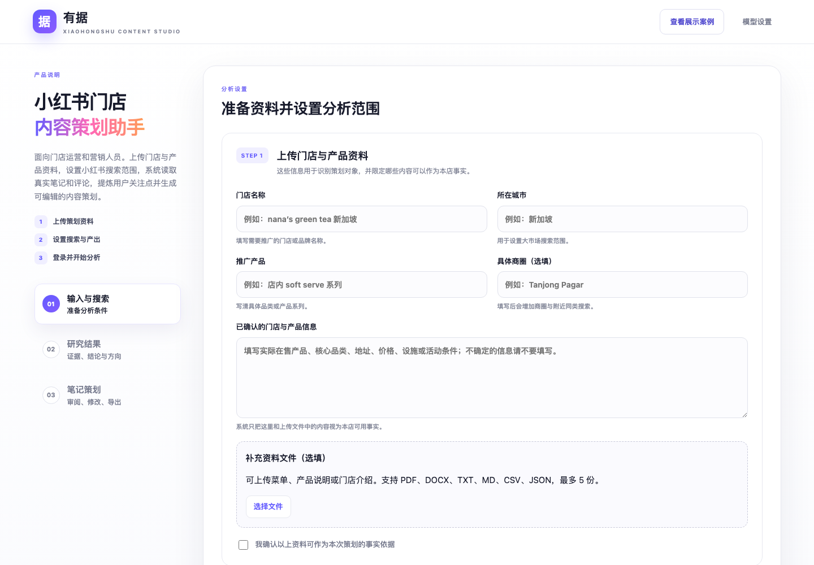
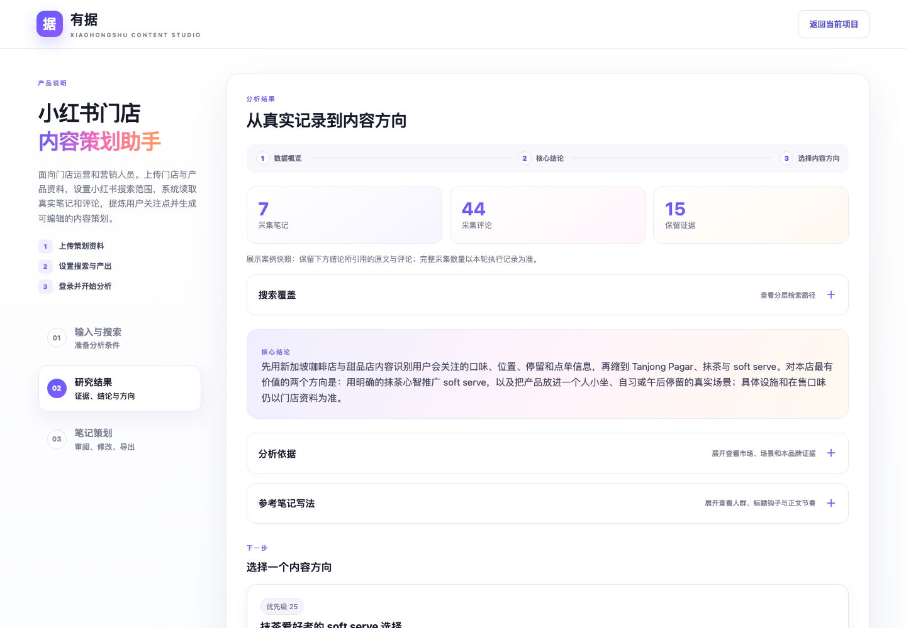

# 有据 Youju

### AI Social Insights & Content Planner

**小红书洞察与内容策划 AI：从消费者关注点出发，为品牌找到值得讲的内容。**

有据面向门店经营者、品牌营销与内容运营人员，将商家提供的产品资料与小红书真实笔记、评论结合，帮助用户判断推广应该突出哪些卖点、面向哪些消费场景，并生成可修改、有来源依据的笔记策划。

[打开产品](https://vibrant-communication-production-e59e.up.railway.app/) · [开发与部署说明](docs/DEVELOPMENT.md)

## 解决什么问题

知道要推广什么产品，只是策划的起点。品牌还需要回答：消费者为什么会感兴趣？他们在同类产品中关注什么？哪些需求能与自己的产品优势匹配？

有据把这些问题串成一条工作路径：**推广目标 → 社媒研究 → 消费者关注点 → 品牌选题 → 内容草稿 → 人工审核。** 用户可以看到策划结论，也能展开查看支持结论的原文证据。

## 功能流程

产品以三步工作台承载这条流程：先提供资料并设置范围，再审阅研究证据和内容方向，最后生成、修改与导出笔记策划。

## 你会得到什么

| 产出 | 帮助你做出的判断 |
| --- | --- |
| 消费者关注点与来源引用 | 了解样本中用户在意的口味、价格、位置、体验与使用场景 |
| 内容方向与选题依据 | 将用户需求与本店资料匹配，决定这次突出什么卖点 |
| 一组小红书笔记策划 | 查看标题、正文与简要拍摄建议，组织产品与场景内容 |
| 可编辑、可导出的策划单 | 人工调整后导出 Markdown，用于后续创作与执行 |

## 如何使用

### 1. 提供品牌与产品资料

填写门店、城市和推广对象，补充已确认的产品信息。支持上传 PDF、DOCX、TXT、MD、CSV、JSON 资料，作为策划对象的事实参考。

### 2. 设置研究与内容偏好

选择笔记读取范围、生成篇数，以及产品、场景或自定义策划偏好。系统按三个层级组织研究：

- **区域市场：** 了解当地相关消费内容中的关注点。
- **细分品类与场景：** 缩小到更接近的产品、商圈与使用需求。
- **本店与品牌：** 在有相关评价时，补充消费者对本店的反馈。

### 3. 研究、审阅并生成内容

使用自己的模型 API Key，并通过页面登录自己的小红书账号。研究完成后，查看关注点及证据、选择策划方向，再生成和修改笔记。中间分析可折叠，来源仍可展开查阅。

实时研究依赖小红书登录状态及平台访问限制，可能无法完成；内置展示案例可以独立查看。

## 先体验一个完整案例

进入产品，点击 **「查看展示案例」**，即可查看新加坡 **nana’s green tea 的 soft serve 推广案例**，无需配置 API Key 或登录小红书。

案例展示了如何将抹茶偏好、舒适停留等消费者关注点，结合本店资料转化为产品与场景选题，再形成三篇笔记策划。用户评价作为关注点参考，具体门店承诺仍需资料确认。

展示包含分层研究、来源证据及最终策划，来自已归档的真实研究记录；打开案例不会重新采集数据或调用模型，也不会覆盖当前项目。

### 从真实记录提炼内容方向

案例共分析 **7 篇笔记与 44 条评论**，在公开快照中保留 15 条用于支撑结论的证据。研究结果将区域市场、细分场景与本店信息分别呈现，避免把相邻品类或其他品牌的事实直接套用到策划对象。

### 把关注点转化为一组笔记

系统将研究结果收敛为抹茶品类心智、午后舒适停留和 soft serve 点单决策三个内容方向，并生成对应的标题、正文与拍摄建议，供营销人员继续修改。

## AI 如何参与

有据目前采用 **AI Workflow**，由程序组织研究、检索、分析、生成与检查的执行顺序。

| 环节 | 实现方式 |
| --- | --- |
| 社媒研究 | FastMCP 封装只读小红书搜索、正文与评论工具，Playwright 负责浏览器访问 |
| 证据检索 | jieba + BM25 轻量 RAG，从已收集内容中检索相关证据 |
| 洞察与创作 | 分阶段结构化 Prompt，分别完成关注点提取、品牌匹配与笔记生成 |
| 质量检查 | 结合程序规则与模型检查，核对引用、事实及标题正文质量 |
| 产品交付 | FastAPI 后端、HTML/CSS/JavaScript 前端，Docker + Railway 部署 |

商家资料定义产品事实，社媒内容提供需求与表达参考，人工审核决定最终采用什么内容。

## 当前阶段与下一步

目前已完成可在线体验的 MVP 和完整展示案例，适合验证从社媒研究到内容策划的流程。小批量社媒样本用于提供策划线索；尚未验证对到店、销售或品牌增长的实际影响。

后续优先完善数据接入稳定性，并通过策划耗时、内容采纳率与发布表现评估价值。在此基础上，探索 ReAct Agent 按证据缺口自主补充研究；当前版本尚未采用这一架构。

---

需要本地运行或自行部署？查看 [开发与部署说明](docs/DEVELOPMENT.md)。第三方内容说明见 [THIRD_PARTY_NOTICES.md](THIRD_PARTY_NOTICES.md)。
